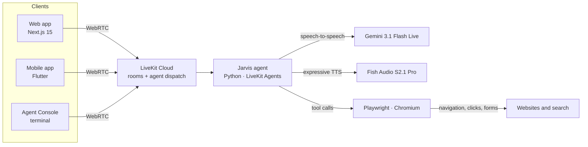

# Jarvis AI

**A voice-first AI butler that talks, listens, and actually operates the web.**

Jarvis is a real-time conversational agent built on [LiveKit Agents](https://github.com/livekit/agents)
and Google's Gemini Live speech-to-speech model. It holds low-latency voice
conversations, switches languages mid-sentence, and drives a real Chromium
browser on your behalf — opening sites, reading pages, clicking, typing, and
searching the web while you talk to it.

It ships with a Python agent, a Next.js web client, and a Flutter mobile client,
so you can talk to the same assistant from a browser, a phone, or your terminal.


---

## Overview

Most voice assistants stop at text generation. Jarvis closes the loop: it hears
you, reasons about what you want, and then does it in a real browser — with a
persona that stays consistent, in fourteen languages.

| Capability | How it works |
|---|---|
| **Real-time voice** | Gemini 3.1 Flash Live (speech-to-speech) over LiveKit WebRTC, with sub-second turn taking |
| **Butler persona** | A formal, dryly sarcastic assistant who calls you "sir" or "madam" and always answers *"Jarvis, you there?"* with *"At your service, Sir."* |
| **Multilingual** | Detects and mirrors the speaker's language automatically; explicit `switch_language` tool covers 14 languages |
| **Browser control** | 11 Playwright tools — navigate, inspect, click, type, scroll, switch tabs, screenshot, and search |
| **Expressive speech** | Fish Audio S2.1 Pro with expressive markup for emotion and pacing |
| **Turn intelligence** | LiveKit turn detector, adaptive interruption handling, and preemptive generation |
| **Clean audio** | AI Coustics noise cancellation on every session |
| **Voice + vision** | Sessions accept both audio and video input from any LiveKit client |

---

## Architecture



The agent is a single `AgentSession` that joins the LiveKit room. Tool calls are
executed server-side against a lazily launched browser, so ordinary conversation
never pays the cost of starting Chromium.

---

## Repository structure

```
Jarvis_ai/
├── .github/                          # Repository automation
└── jarvis/
    ├── src/
    │   ├── agent.py                  # Persona, session config, language tool
    │   └── browser.py                # Playwright toolset (11 tools)
    ├── tests/test_agent.py           # Unit tests
    ├── scenarios.yaml                # Simulation scenarios for CI
    ├── Dockerfile                    # Production image for LiveKit Cloud
    ├── frontend/                     # Next.js web client
    └── livekit_flutter_starter/      # Flutter mobile client
```

---

## Tech stack

| Layer | Technology |
|---|---|
| **Agent runtime** | Python 3.10+ · [LiveKit Agents](https://github.com/livekit/agents) 1.8 |
| **Reasoning + speech** | Google Gemini 3.1 Flash Live (`gemini-3.1-flash-live-preview`) |
| **Text-to-speech** | Fish Audio S2.1 Pro (LiveKit Inference) |
| **Browser automation** | Playwright (Chromium) |
| **Web client** | Next.js 15 · React 19 · Tailwind CSS 4 · LiveKit Components |
| **Mobile client** | Flutter · `livekit_components` · `livekit_client` |
| **Tooling** | uv · ruff · pytest · pnpm · Docker · GitHub Actions |

---

## Getting started

### Prerequisites

| Requirement | Notes |
|---|---|
| Python 3.10 – 3.14 | Agent runtime |
| [uv](https://docs.astral.sh/uv/) | Python dependency manager |
| [LiveKit CLI](https://docs.livekit.io/intro/basics/cli/) 2.18.8+ | `winget install LiveKit.LiveKitCLI` on Windows |
| [LiveKit Cloud](https://cloud.livekit.io/) project | Provides URL + API key + secret |
| Google AI API key | Powers Gemini Live |
| Node.js 24 + pnpm 9 | Web client only |
| Flutter 3.5+ | Mobile client only |

### 1. Run the agent

```bash
cd jarvis
uv sync
uv run playwright install chromium
```

Create your environment file and fill in the credentials:

```bash
cp .env.example .env.local
```

Or let the CLI write them for you:

```bash
lk cloud auth
lk app env --write --destination .env.local
```

Then start it:

```bash
# Talk to it straight from the terminal
lk agent console

# Connect it to LiveKit Cloud so the web and mobile clients can reach it
lk agent dev
```

Production entry point:

```bash
uv run src/agent.py start
```

### 2. Run the web client

```bash
cd jarvis/frontend
pnpm install
cp .env.example .env.local
pnpm dev
```

Open <http://localhost:3000>. Either set `LIVEKIT_TOKEN_SERVER_ID`, or fill in
`LIVEKIT_URL`, `LIVEKIT_API_KEY`, and `LIVEKIT_API_SECRET` to use the bundled
token endpoint. Set `AGENT_NAME=my-agent` for explicit dispatch.

### 3. Run the mobile client

```bash
cd jarvis/livekit_flutter_starter
flutter pub get
flutter run
```

Create `assets/.env` next to your Flutter assets with the connection details:

```dotenv
LIVEKIT_SANDBOX_ID=
LIVEKIT_AGENT_NAME=my-agent
LIVEKIT_AGENT_DEPLOYMENT=
```

---

## Configuration

| Variable | Component | Purpose |
|---|---|---|
| `LIVEKIT_URL` | Agent, web | LiveKit Cloud WebSocket URL |
| `LIVEKIT_API_KEY` | Agent, web | API key for the project |
| `LIVEKIT_API_SECRET` | Agent, web | API secret — **never commit** |
| `GOOGLE_API_KEY` | Agent | Gemini Live access |
| `LIVEKIT_TOKEN_SERVER_ID` | Web | Development token server (alternative to raw keys) |
| `AGENT_NAME` | Web | Agent name for explicit dispatch |
| `JARVIS_BROWSER_PROFILE` | Agent | Fixed Chromium profile path, e.g. to persist a login |
| `JARVIS_HEADLESS` | Agent | `1` runs the browser without a window |

All `.env*` files except `.env.example` are git-ignored. See
[`jarvis/.env.example`](jarvis/.env.example) and
[`jarvis/frontend/.env.example`](jarvis/frontend/.env.example).

---

## What Jarvis can do

Voice interactions worth trying:

```
"Jarvis, you there?"
"Open Wikipedia and tell me what today's featured article is."
"Search YouTube for lo-fi playlists and play the first one."
"Switch to Hindi."
"What's the current weather in Bengaluru?"
```

Behavioural rules are enforced in [`jarvis/src/agent.py`](jarvis/src/agent.py):

- **Read-only browser actions** — opening pages, scrolling, inspecting, screenshotting — run immediately.
- **Consequential actions** — submitting, sending, purchasing, deleting — require explicit confirmation first.
- **Safety guardrails** — declines harmful or unlawful requests and gives general-only guidance for medical, legal, and financial topics.

### Language support

English, Hindi, Spanish, French, German, Italian, Portuguese, Japanese, Korean,
Chinese (Mandarin), Arabic, Russian, Dutch, and Turkish. Language is mirrored
automatically; no tool call is needed unless the user explicitly asks to switch.
To add a language, extend `SUPPORTED_LANGUAGES`, `LANGUAGE_CONFIRMATIONS`, and
`LANGUAGE_ALIASES` in `agent.py`.

### Browser toolset

| Tool | Purpose |
|---|---|
| `open_url` | Navigate to an address |
| `inspect_page` | Read title, URL, and interactive elements with stable refs |
| `click` | Click an element by ref |
| `type_text` | Type into a field, optionally submitting |
| `scroll` | Scroll the viewport |
| `go_back` | Navigate back in history |
| `wait_for` | Pause for slow pages |
| `switch_tab` / `close_tab` | Manage browser tabs |
| `screenshot` | Capture the current page |
| `search_web` | Search DuckDuckGo in the agent's browser |

The browser launches only on first use and closes with the session. Each
session gets its own profile, so concurrent sessions — including CI
simulations — never collide.

---

## Testing

```bash
cd jarvis
uv run pytest                 # unit tests
uv run ruff check             # lint
uv run ruff format --check    # formatting
```

Conversation-level tests run as **LiveKit simulations**: a simulated user holds a
full multi-turn conversation and each transcript is judged against
`agent_expectations`. Eight scenarios cover greeting, grounding, guardrails,
browser navigation, search, language switching, and persona consistency.

```bash
lk agent simulate text --scenarios scenarios.yaml
```

The [Simulations workflow](jarvis/.github/workflows/simulations.yml) runs the
same suite on every merge to `main`. It needs `LIVEKIT_URL`,
`LIVEKIT_API_KEY`, and `LIVEKIT_API_SECRET` configured as repository secrets.

---

## Deployment

The agent ships with a production `Dockerfile`:

```bash
cd jarvis
docker build -t jarvis-agent .
docker run --env-file .env.local jarvis-agent
```

For LiveKit Cloud:

```bash
lk agent deploy
```

See the [agent deployment guide](https://docs.livekit.io/deploy/agents/) for
regions, secrets, and rollouts. The web client deploys to any Node host
(Vercel, Docker, or `next start`).

---

## Security

- `.env`, `.env.local`, and all `.env.*` variants are ignored; only `.env.example` is tracked.
- The browser profile, screenshots, virtual environments, and build output are ignored.
- Rotate `LIVEKIT_API_SECRET` and `GOOGLE_API_KEY` immediately if either is ever committed.
- Consequential browser actions always require explicit user confirmation.

---

## Acknowledgements

Built on the LiveKit starter ecosystem:

- [agent-starter-python](https://github.com/livekit-examples/agent-starter-python) — agent scaffold
- [agent-starter-react](https://github.com/livekit-examples/agent-starter-react) — web client
- [livekit_flutter_starter](https://github.com/ruxakK/livekit_flutter_starter) — mobile client
- [LiveKit Agents](https://github.com/livekit/agents) and [LiveKit Cloud](https://livekit.io/)

---

## License

Released under the [MIT License](LICENSE).
